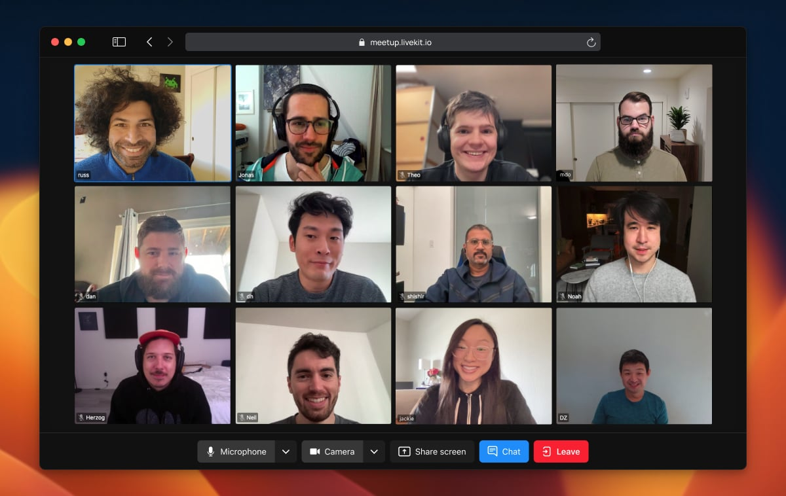
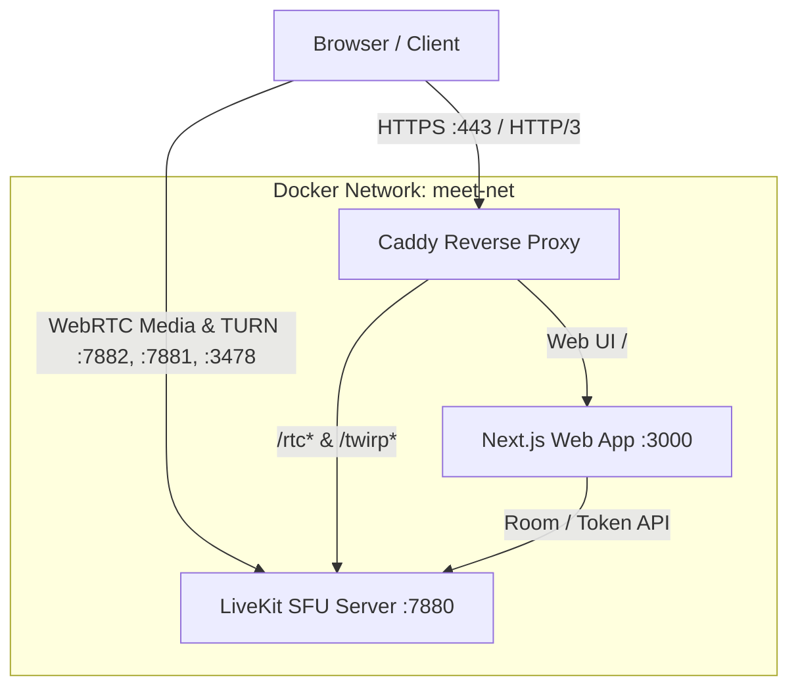

# LiveKit Meet Docker

[](https://www.docker.com/)
[](https://livekit.io/)
[](https://nextjs.org/)
[](LICENSE)

> **A lightweight self-hosted alternative to Jitsi and Zoom.**<br>Docker Compose stack bundling [LiveKit SFU](https://livekit.io/), [LiveKit Meet](https://github.com/livekit-examples/meet), and [Caddy](https://caddyserver.com/) with automated TLS.



---

## Highlights

- **WebRTC SFU:** Low-latency architecture for multi-party audio/video conferencing.
- **End-to-End Encryption (E2EE):** Built-in client-side encryption.
- **Noise Cancellation:** Client-side RNNoise audio processor with zero cloud dependencies.
- **Room Recording:** Server-side recording to S3-compatible storage via Egress.
- **Automated SSL/TLS:** Certificate management (Let's Encrypt / ZeroSSL) and HTTP/3 via Caddy.
- **Optimized Container:** Multi-stage Next.js build based on Alpine Linux running under a non-root user.
- **Modular Ingress:** Run with the bundled Caddy reverse proxy or integrate into an existing network (Nginx, Traefik, NPM).

---

## Prerequisites

### 1. Kernel UDP Buffer Sizing
WebRTC media traffic uses UDP bursts. Increase maximum socket buffer sizes to prevent packet loss:

`/etc/sysctl.d/99-livekit.conf`
```ini
# Standard (8MB) | High-load (64MB): 67108864
net.core.rmem_max=8388608
net.core.wmem_max=8388608
```

Apply changes:
```bash
sudo sysctl --system
```

### 2. Firewall / Port Allocations

Ensure the following ports are reachable on the host:

| Port | Protocol | Service | Purpose |
| :--- | :--- | :--- | :--- |
| **80** | TCP | Caddy | HTTP (ACME challenge) |
| **443** | TCP / UDP | Caddy | HTTPS / HTTP/3 (Web UI and WebRTC signaling) |
| **7881** | TCP | LiveKit | WebRTC fallback over TCP |
| **7882** | UDP | LiveKit | WebRTC media traffic (RTP/RTCP) |
| **3478** | UDP | LiveKit | Integrated TURN server |

---

## Quick Start

### 1. Clone Repository

```bash
git clone https://github.com/mikhailde/livekit-meet-docker.git
cd livekit-meet-docker
```

### 2. Configuration Setup

Copy the example configuration files:

```bash
cp .env.example .env
cp build.env.example build.env
cp config/livekit.yaml.example config/livekit.yaml
```

Generate API credentials using the official LiveKit Docker image:

```bash
docker run --rm livekit/livekit-server generate-keys
```

Configure `.env` with your domain and generated credentials:

```env
DOMAIN=meet.example.com
LIVEKIT_URL=wss://meet.example.com

LIVEKIT_API_KEY=your_api_key
LIVEKIT_API_SECRET=your_api_secret

COMPOSE_PROFILES=caddy
DOCKER_NETWORK=meet-net
EXTERNAL_NETWORK=false
```

Configure frontend build settings in `build.env`:

```env
NEXT_PUBLIC_SHOW_SETTINGS_MENU=true
```

Review `config/livekit.yaml`:
```yaml
rtc:
  udp_port: 7882
  tcp_port: 7881
  use_external_ip: true # Detects public IP via STUN

turn:
  enabled: true
  udp_port: 3478

audio:
  active_red_encoding: true
```

> [!NOTE]
> For advanced server options (Redis clustering, TURN authentication, Webhooks, custom codecs), refer to the official [config-sample.yaml reference](https://github.com/livekit/livekit/blob/master/config-sample.yaml).

### 3. Build and Launch

Build and start the services in detached mode:

```bash
docker compose up -d --build
```

Monitor container health and certificate generation:

```bash
docker compose ps
docker compose logs -f caddy
```

---

## Architecture & Traffic Flow



---

## Room Recording (Egress)

To enable room recording to S3-compatible storage:

1. **Configure `.env`**:
   * Add `egress` to profiles: `COMPOSE_PROFILES=caddy,egress`
   * Add your S3 credentials:
     ```env
     S3_KEY_ID=your_s3_access_key
     S3_KEY_SECRET=your_s3_secret_key
     S3_BUCKET=your_s3_bucket_name
     S3_ENDPOINT=https://s3.amazonaws.com
     S3_REGION=us-east-1
     ```
2. **Create Egress config:**
   ```bash
   cp config/egress.yaml.example config/egress.yaml
   ```
3. **Enable Redis** in `config/livekit.yaml`:
   ```yaml
   redis:
     address: redis:6379
   ```
4. **Enable recording UI** in `build.env`:
   ```env
   NEXT_PUBLIC_LK_RECORD_ENDPOINT=/api/record
   ```
5. **Apply changes:**
   ```bash
   docker compose up -d --build
   ```

---

## External Reverse Proxy

To route traffic through an existing reverse proxy (e.g., Nginx, Traefik, NPM) instead of Caddy:

1. In `.env`, disable the Caddy profile and connect to your Docker network:
   ```env
   COMPOSE_PROFILES=
   EXTERNAL_NETWORK=true
   DOCKER_NETWORK=your_proxy_network
   ```

2. Forward incoming traffic:
   - Route `/rtc*` and `/twirp*` to `http://livekit:7880` (WebSocket / Upgrade headers must be enabled).
   - Route all other requests (`/`) to `http://meet:3000`.

---

## Custom Minimal UI

To replace the default demo landing page with the bundled minimalist templates:

```bash
cp templates/app/layout.tsx meet/app/layout.tsx
cp templates/app/page.tsx meet/app/page.tsx
docker compose up -d --build meet
```

---

## Operations & Maintenance

- **View service logs:**
  ```bash
  docker compose logs -f meet
  docker compose logs -f livekit
  ```

- **Update the Meet application (Git Subtree):**
  The `meet` folder is tracked via Git subtree. To pull changes from upstream:
  ```bash
  git subtree pull --prefix meet https://github.com/livekit-examples/meet.git main --squash
  docker compose up -d --build meet
  ```

---

## References

- [LiveKit Documentation](https://docs.livekit.io/)
- [LiveKit Server Sample Configuration](https://github.com/livekit/livekit/blob/master/config-sample.yaml)
- [LiveKit Egress Documentation](https://docs.livekit.io/home/self-hosting/egress/)
- [LiveKit Meet Source Repository](https://github.com/livekit-examples/meet)

---

## License

This project configuration is licensed under the [Apache 2.0 License](LICENSE). LiveKit is a registered trademark of [LiveKit, Inc.](https://livekit.io/).